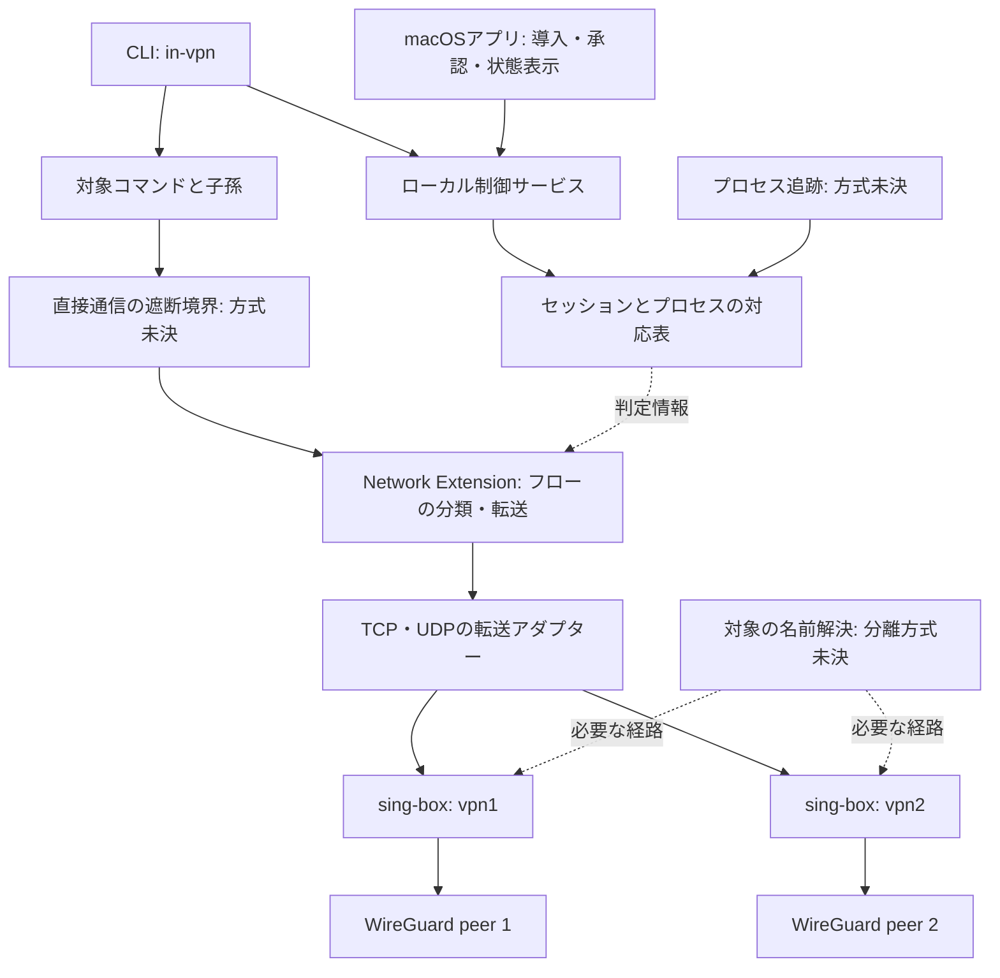

# in-vpn のアーキテクチャ

作成日: 2026-10-06（JST）／更新日: 2026-10-07（JST）  
状態: 完全隔離の構成は未確定。2026-10-09に[部分CLI](implementation.md)を実装した。以下の全体構成は完成方式の候補として保持する。

初版の採用範囲は[決定記録0003](decisions/0003-explicit-partial-cli.md)。PythonのCLI・プロファイル・userspace WireGuardバックエンド、Swift/Cの独立したTCP Providerを実装した。proxyと指定宛先TCPの実験を明示的な別モードにし、通常起動では追跡・DNS・遮断の不足を理由に実行前に拒否する。製品コードはexperiments/test-supportに依存しない。

要件は [purpose.md](purpose.md)、方式を決める事前実験は [feasibility.md](feasibility.md)、実装後の合否は [verification.md](verification.md)、コードと証跡の配置は [directory-layout.md](directory-layout.md) に定義する。

製品の構成を固定する前にF00〜F08で情報を集める。最小の検証用ランチャー・Host/Extensionを使い、以下の製品CLI、常駐サービス、UIが完成していることを前提にしない。追跡・DNS・遮断が同時に成立した証跡を受けて、採用するAPIと責務を確定する。

2026-10-07の[初回実測](evidence/feasibility/20261007-initial/report.md)では、定期一覧での子孫追跡とsandbox継承FDに反例を得た。[追加実測](evidence/feasibility/20261007-tailscale-off/report.md)では、同一バイナリの既知PIDを使うTCP・UDP各100組の選別、NAT64を含むシステムcurlの選別、getaddrinfoの元PID取得が成立した。一方、Providerクラッシュ後にBの直接TCPが再開することを別起動でも再現した。外部HTTPSでもクラッシュ後にBの10回中8回でHTTP 200を確認した。透明Provider単独はR5の遮断境界として採用しない。子孫追跡・DNSキャッシュ分離・VPNへの透明転送・独立した遮断機構は未確定である。

URLがIPv4リテラルでも実接続先がNAT64のIPv6になる場合を観測した。宛先文字列だけでアドレス族や保護範囲を決めず、実フローと受信側の観測で照合する。DNSは標準getaddrinfoと直接DNSソケットでドメインルールの適用が異なったため、両経路を別々に検証する。

部分判断は [決定記録0001](decisions/0001-feasibility-boundaries.md) に保存した。

[第2報](report-2.md)で、通常のcurlとUDPソケットからNE→中継→SOCKS→WireGuardへの転送、および2本のローカルWireGuardの分離が成立した。一方、POSIXセッションIDはsetsidで所属が外れ、標準DNSは別VPN・通常セッションへ先の回答を共有した。TTL=0でも直後の再利用で再現した。単純なContent Filterは正常な透明転送も阻止し、自身のクラッシュ後は直接通信を許した。この3候補をそのまま製品へ採用しない。詳細な判定は[決定記録0002](decisions/0002-routing-established-isolation-rejected.md)に保存した。

## 設計の中心

通信を選ぶ単位は実行ファイルではなく、CLIが作成する**実行セッション**とする。セッションはVPNプロファイル、起点プロセス、子孫プロセスの集合、保護状態を持つ。フロー発生時にOS由来のプロセス情報をセッションへ結び付け、そのセッションのVPNへ転送する。

アプリ名・実行パス・UID・環境変数だけでは、同じツールをVPN内外で使う要件を満たさない。識別情報、プロセスイベント、通信イベントを競合なく結び付けられるかが最初の技術的な検証事項になる。

## 公式仕様から分かる制約

2026-10-06に次の公式資料を確認した。APIの存在と、目的全体の実現可能性は分けて扱う。

| 仕様上の事実 | 設計への影響 |
| --- | --- |
| sing-boxのルールにはmacOS向けの `process_name`・`process_path` がある | 同一実行ファイルの実行ごとの区別には別の仕組みが必要。[Route Rule](https://sing-box.sagernet.org/configuration/route/rule/) |
| `NEFlowMetaData.sourceAppAuditToken` はフロー発生元のaudit tokenを提供する省略可能な値 | OS由来の識別候補。欠落、短命プロセス、execとの関係は実機検証する。[sourceAppAuditToken](https://developer.apple.com/documentation/networkextension/neflowmetadata/sourceappaudittoken) |
| `NETransparentProxyProvider` が新規フロー処理で `false` を返すと、直接通信が継続する | 対象フローのエラー処理で `false` を返してはならない。[NETransparentProxyProvider](https://developer.apple.com/documentation/networkextension/netransparentproxyprovider) |
| 透明プロキシは設定中の `NEDNSSettings`・`NEProxySettings` を無視し、名前で接続するAPIもDNS解決を省略しない | DNSを専用の未解決課題とする。同じ資料に基づく |
| Network Extensionの利用にはentitlementが必要で、Mac App Store外配布にはDeveloper ID向けの署名・プロファイル設定がある | CLI単体やNixへのパッケージ追加だけでは導入は完結しない。[Network Extensions Entitlement](https://developer.apple.com/documentation/bundleresources/entitlements/com.apple.developer.networking.networkextension) |
| Endpoint Securityにはfork等のイベントがあり、利用entitlementはAppleへの申請を要する | 追跡候補の一つ。利用可能と仮定せず、申請・承認の必要性を評価する。[Endpoint Security](https://developer.apple.com/documentation/endpointsecurity)、[entitlement](https://developer.apple.com/documentation/bundleresources/entitlements/com.apple.developer.endpoint-security.client) |

以下の構成はこれらの制約から立てた設計仮説であり、公式資料がこの構成の成立を保証しているわけではない。

## 構成と責務



図は論理的な責務を示す。遮断境界とDNS分離には、まだ選定済みの実装がない。別プロセス・別Extensionが必須かどうかも検証して決める。

| 構成要素 | 責務と初期案 |
| --- | --- |
| CLI | プロファイル指定、実行セッションの作成、コマンド起動、端末・終了状態の引き継ぎ。Swiftを初期候補とする |
| macOSアプリ | Extensionの導入・OSの承認導線、状態・障害の表示。通常のコマンド実行はCLIから完結させる |
| 制御サービス | 認証したローカル要求の受理、セッション管理、バックエンドの準備、状態遷移。配置と権限は検証後に確定する |
| プロセス追跡 | fork・exec・exitと再親化を扱い、プロセスの世代を区別する。イベント源は未選定 |
| Network Extension | 発生元とセッションを照合してTCP・UDPフローを処理。`NETransparentProxyProvider` を第一候補にする |
| 転送アダプター | フローのストリーム／データグラムをsing-boxのローカル入力へ接続。TCPはSOCKS5 CONNECT、UDPはSOCKS5 UDP ASSOCIATEを候補に実証する |
| VPNバックエンド | 初期案はプロファイルごとにsing-boxプロセスと入力口を分離し、WireGuardへ送る。構文と機能は採用バージョンで確認する |
| 遮断境界 | Providerや制御サービスが消えても対象の直接通信を防ぐ。OSの制約機構・継承可能なサンドボックス等を調査し、失敗時の動作を確認して選ぶ |
| DNS分離 | 元の要求プロセスとVPNの対応を維持して解決する。標準リゾルバーを含めて成立する方式は未決 |

## CLIの契約案

```sh
in-vpn vpn1 curl https://example.com
in-vpn vpn1 shell
in-vpn vpn2 -- command arg1 arg2
```

引数は配列のまま実行し、暗黙の `sh -c` や文字列の再評価をしない。`--` はコマンド境界の明示に使い、`shell` という名前の実行ファイルも `-- shell` で指定できる案とする。`shell` 操作は利用者の対話シェルを選び、cwdと通常の環境を引き継ぐ。

PATH上のNix導入ツールや既存ファイルをそのまま使う。ファイル・端末・UNIXソケットと、起動前から開いているIPソケットの継承は区別する。保護不能な外部向けソケットの持ち込みは、起動前に検出・拒否する方式を検証する。

子の終了状態をCLIへ反映し、割り込み・停止・再開・端末サイズ変更を伝える。準備失敗はコマンド実行前に非ゼロ終了し、理由を標準エラーへ出す。詳細な終了コードは実装時に定義する。

初期版はセッション内からの `in-vpn` の入れ子を明示的に拒否する。別VPNへの上書きや二重トンネルは暗黙に導入しない。

## セッションとプロセスの識別

概念上のデータモデルは次のとおり。具体的な保存形式はまだ決めない。

| データ | 必要な情報 |
| --- | --- |
| VPNプロファイル | 名前、プロトコル、秘密情報への参照、DNS方針、バックエンド設定の版 |
| セッション | 推測困難なID、所有ユーザー、VPN名、起点プロセス、状態、制御サービスの世代 |
| プロセス所属 | OS由来の識別子、PIDと世代を区別する情報、親子関係、所属セッション、生存状態 |
| フロー | 発生元の識別情報、セッション、TCP/UDP、宛先、転送先、開始・終了・エラー状態 |

`sourceAppAuditToken` を照合の候補にするが、PIDだけを取り出して永続的なキーにはしない。execの前後やPID再利用時に、どの情報を更新・失効させるかを検証する。

親子関係は生成時に取り込み、親の終了後も所属を保持する。後からPPIDをたどる方法、定期的なプロセス一覧の取得、環境変数の継承だけで確実性を主張しない。環境変数は表示補助には使えても認可の根拠にはしない。

フロー到着が子プロセス登録より先になる競合を想定する。判定は「対象」「対象外と確認済み」「未確定」の3つに分ける。対応表に存在しないことだけで対象外とは判断しない。未確定フローは保留し、確定できなければエラーにする方式を候補とする。

この保留が無関係なアプリを広く止めるならR7を満たさない。対象の漏れを防ぐことと対象外を維持することを同時に実証できなければ、追跡・遮断方式を再設計する。イベント欠落、処理遅延、IPC切断を正常扱いにしない。

## 起動・終了と保護状態

```text
preparing → protected → running → draining → closed
     └────────── 準備失敗 → closed（コマンド未実行）
                 protected / running / draining → blocked
```

1. プロファイル・署名・権限・Provider・追跡機能を確認する。
2. バックエンドとVPN内DNS経路を準備する。プロセス生存だけで利用可能とは判定しない。
3. 起点プロセスをユーザーコードが通信を開始できない状態で用意し、遮断と所属登録を完了する。停止状態での生成等を候補に、保証可能な開始手順を選ぶ。
4. Providerと制御サービス間で保護状態の反映を確認してから実行を開始する。この順序だけでは子孫の生成競合は解けないため、追跡側でも検証する。
5. 起点終了後は `draining` とし、生存する子孫の保護を維持する。最後の対象とフローが終了してから所属・バックエンドを解放する。
6. 故障時は `blocked` として通信を遮断する。安全な再確立が検証されるまで自動的に保護を解除しない。保護を維持できない場合の対象停止・終了手順も検証する。

CLIや制御サービスのクラッシュで対応表が消えた場合にも、生存する対象を対象外と見なしてはならない。再起動時に所属と遮断状態を再構築できなければ、対象を遮断したまま安全に終了させる。保存したPID一覧だけで再構築しない。

## TCP・UDPの経路

対象フローを受け入れ、元の宛先を保持して選択VPNの入力口へ接続する。TCPでは半切断、逆方向の読み書き、バックプレッシャー、キャンセルを扱う。UDPでは宛先ごとのデータグラム、戻り先、サイズ制限、タイムアウト、アソシエーションの寿命を扱う。HTTPプロキシでTCPが動いたことをUDP対応の証拠にしない。

対象外と確認できたフローだけを元の経路へ通す。対象の転送失敗はフローを閉じ、直接接続へフォールバックしない。IPv6、LAN、loopbackも同じ方針に含め、未対応のものは遮断する。

Provider自身とsing-boxの通信が再度捕捉されるループを防ぐ。除外は管理下のプロセス実体と必要な接続先に限定し、同名実行ファイルや任意のローカルクライアントへ広げない。バックエンドの待ち受けはローカル限定とし、認証・アクセス制御を設ける。VPN向け経路にdirectへの代替経路を設けない。

## DNSは独立した成立条件

対象プロセスの `getaddrinfo` 等がシステムサービスへ名前解決を委譲した場合、観測した通信の発生元だけで元セッションを識別できるとは限らない。透明プロキシへDNS設定を追加したり、Mac全体のリゾルバーをVPNへ変えたりしてR4達成とはしない。

標準リゾルバーの要求をセッション別に扱う方法を先に検証する。DNS Proxy等のAPIも候補になり得るが、元プロセスへの帰属、他アプリとの分離、権限、既存キャッシュとの関係を実証してから採用する。ライブラリ注入やプロキシ専用リゾルバーだけでは任意ツール対応の根拠にならない。

アプリが直接行うUDP/TCP DNS、DoT、DoHは、それ自体の通信も指定VPNへ流す。標準リゾルバーのVPN内DNS利用と、アプリ独自のDNS通信の経路保護は別々に検証する。VPNサーバーの初期接続で必要な名前解決は、対象アプリのDNSと分けて設定・観測する。

## 障害時の遮断は独立した成立条件

Providerが稼働中にエラーを返せることと、Providerが停止しても遮断が残ることは異なる。ヘルスチェック、launchdによる再起動、クラッシュ検出後の子プロセスkillだけでは、検出までの漏れを防ぐ根拠にならない。

対象の生存期間を通じて有効な遮断機構を選び、VPNバックエンド停止、Provider停止、制御サービス停止、同時故障で確認する。既存のプロキシwrapperとサンドボックスは比較用の参考とし、透過転送と同時に成立すると仮定しない。

TCP・UDP以外の通信や継承ソケットが遮断境界を迂回する可能性も扱う。対象だけを選ぶ遮断が成立しなければ、透明プロキシ案を完成仕様として採用しない。

## 権限・秘密情報・配布

制御用IPCはXPC等のローカル機構を候補とし、呼び出し元のOS由来の身元と所有ユーザーを検証する。クライアントの自己申告PIDやセッションIDだけで、他プロセスの経路変更を認めない。特権が必要な操作を限定し、コマンド自身をrootで動かす設計にはしない。

秘密情報はKeychainまたは所有者だけが読めるファイルに置き、設定には参照を保持する。ログには秘密鍵・コマンドの全引数・通信本文を出さず、通常はセッションID、状態、エラー理由に限定する。

署名・entitlement・プロビジョニング・公証の要否と手順は、採用する配布形態で確定する。Endpoint Securityを使う場合は追加の権限取得を開発上の依存として明記する。利用者によるOS上の承認と、nix-darwinの宣言的な導入設定を混同しない。

## 判断の順序と未決事項

| 段階 | 判断 | 反証・判定不能の場合 |
| --- | --- | --- |
| F00/F01 | 通常の導入条件で必要な権限を利用でき、同じ実行ファイルの別プロセスを観測・選別できるか | 権限取得、配布条件、識別方式を見直す。権限未取得を技術的不可能とはしない |
| F03/F04を優先、F02/F05 | DNSの帰属と分離、停止時の遮断、子孫追跡、VPN中継がそれぞれ成立するか | 最小反例を残し、該当候補を修正・変更する。製品の作り込みで不確実性を先送りしない |
| F06/F07/F08 | 作業環境・複数VPNを維持し、採用候補を同時に組み合わせられるか | 干渉する責務を再設計する。個別の成功だけでは採用しない |
| 設計確定 | F系列の証跡からAPI・権限・配置・対応条件を選び、決定記録とこの文書を更新する | 必須条件が未解決なら該当方式を確定しない。目的の変更は明示的に合意する |
| 製品実装とV00〜V25 | CLI・macOSアプリとして要件を満たし、配布・導入・運用できるか | 製品を修正し受け入れ試験を再実施。方式に影響する発見はF系列へ戻す |

最低macOS版、プロセス追跡API、DNS分離API、遮断機構、サービスの権限と配置、UDPアダプターの詳細は未決。プロファイルごとの別プロセスは障害と設定の分離を優先した初期案で、資源消費が問題になれば分離の保証を維持した統合を検討する。
