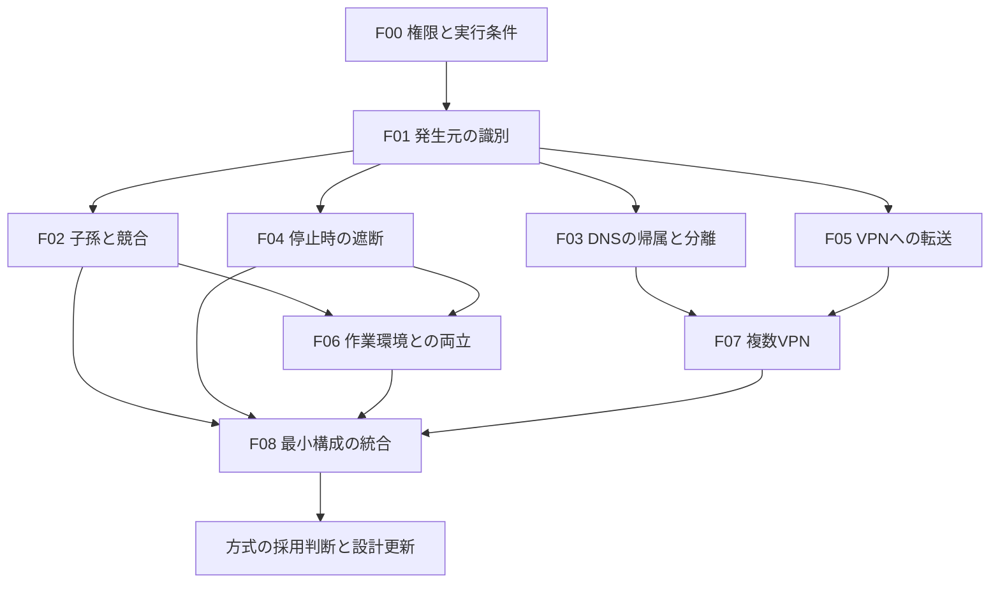

# macOSの事前不確実性テスト

作成日: 2026-10-07（JST）  
状態: 2026-10-07にF00〜F07の一部を実装・実行。[最新の実測報告](report-2.md)。F系列全体は未完了で、製品方式は未確定。

## 第2報の位置づけ

2026-10-07の[report-2.md](report-2.md)に、F02のセッションID候補、F04の独立Content Filter、F05の透明転送、F07の2本のローカルWireGuardとDNS比較の実測を追加した。外部TCPとローカルTCP/UDP転送は部分成立。子孫追跡・DNS分離・故障時遮断は今回の候補に反例があり不合格。Endpoint Securityは権限不足、外部VPN2本と全条件を満たすF08は未完了。以下の既存試験計画の必要条件を、部分成立に合わせて弱めない。

## この段階で決めること

製品のCLIや常駐アプリを作り込む前に、[目的](purpose.md)をmacOSのどの仕組みで、どの条件まで実現できるかを調べる。情報が足りない部分を、製品設計の前提として固定しない。

現在の [architecture.md](architecture.md) は比較・反証する候補である。事前検証では、最小の試験プログラム、署名した検証用Extension、通信の観測装置だけを作る。完成した `in-vpn`、製品用IPC、設定UI、自動更新は前提にしない。

この文書のF系列は**方式を選ぶための実験**、[verification.md](verification.md) のV系列は**選んだ方式で実装した製品の受け入れ試験**とする。F系列で得た証拠はV系列へ引き継ぐが、実装後の試験を自動的に合格にはしない。

## 不確実性と、それが変える設計

| ID | 確かめる問い | 決定に影響するもの | 状態 |
| --- | --- | --- | --- |
| F00 | 通常のmacOS環境で、必要なAPI・署名・権限を利用できるか | 配布形態、最低OS、Extension構成、追加の権限申請 | 一部実施。開発用NE起動成功、ES拒否、配布未確認 |
| F01 | 同じ実行ファイルの別プロセスを、通信の発生元として区別できるか | セッションの識別子、フローの選別方法 | 一部成立。既知PIDのTCP/UDP各100組、システムcurl選別を確認 |
| F02 | 子孫の生成と最初の通信の競合、親の終了を扱えるか | プロセス追跡方式、起動手順、所属の寿命 | 候補不合格。一覧採取とセッションIDに反例。ESは権限不足 |
| F03 | 標準リゾルバーの要求を元セッションへ帰属させ、DNSを分離できるか | DNS Proxy等の追加機構、キャッシュ方針、基本構成の成立 | 候補不合格。VPN別の新規名は成功、同名回答が別VPN・通常側へ共有 |
| F04 | 通信制御が停止・消失しても、対象だけの直接通信を防げるか | 独立した遮断機構、故障時の保証、基本構成の成立 | 候補不合格。Proxy／Content Filterのクラッシュとsandbox併用に反例 |
| F05 | 受け取ったTCP・UDPをVPNへ中継できるか | 転送アダプター、sing-boxの接続方法、IPv6、ループ回避 | 一部成立。通常TCPの外部VPN転送とUDP中継を確認。一般IPv6・長時間等は残件 |
| F06 | 必要な制約を適用したまま、既存ツールと作業環境を維持できるか | コマンドの起動方式、権限、対応範囲 | 一部実施。基本操作成功。VPN統合未実施 |
| F07 | 同じMacで複数VPNと通常経路を独立して使えるか | バックエンドの分離単位、DNS・状態の分離 | 一部成立。独立ローカルWG2本のTCP/UDP。DNS不合格、外部2本は未実施 |
| F08 | 上記を同時に満たす最小構成が成立するか | 製品実装に進むか、方式を変更するか | 未実施 |

## 実施順と依存関係



F00の環境・配布条件を先に確認し、F01で最小Providerと観測の有効性を確かめる。次は設計を覆す可能性が大きいF03・F04の反証試験を優先し、F02・F05を進める。F03・F04を始めるために完全な子孫追跡やVPN中継を作る必要はない。限定した既知のプロセスを登録し、管理下の試験用宛先を使う。

追加権限の取得待ちなどで一部が実施不能でも、依存しない実験は進められる。ただし未確認の依存をモックで置き換えて、macOS上の成立と判定しない。

最初のVPN経由の実証は、F01とF05を組み合わせた「同じ実行ファイルの内外同時実行」とする。F08はその後、DNS・子孫・遮断まで同時に成立するかを確かめる。

## 共通の実験方法

### 試験装置

- **通常側Aと対象側B**: 同一ユーザー、同一パス・同一ハッシュの実行ファイルを使う。差は試験用ランチャーからの起動・所属指定だけとする。
- **試験用ランチャー**: 子を生成し、起点と生成イベントを記録する最小プログラム。製品CLIではない。F01では既知の起点を登録できるが、F02では子孫を後から手動登録してはならない。
- **通信プローブ**: 通常のBSDソケットによるTCP/UDP、標準DNS、Network.framework/URLSessionを分けて使う。ここでのソケットは `SOCK_RAW` ではない。プロキシ変数の大小文字双方を外し、自動プロキシ利用も記録する。
- **検証用Host/Extension**: フローのメタデータ、受理・保留・拒否・中継の判断と時刻を出す最小構成。DNSや遮断の候補は別の試験構成として有効化する。
- **管理下の受信先**: テストID、連番、接続元を記録するTCP/UDPサーバーと、回答を制御できるDNSリゾルバー。VPNの出口と通常側の経路を区別できる観測点を用意する。
- **採取・故障注入**: プロセスイベント、Providerイベント、パケット、受信ログを採取する。試験対象の停止・遅延注入と後始末はテストIDにひも付ける。

ランチャーの正解データは実際に起動したプロセス・親子関係から作り、ネットワーク側の分類結果と別に保管する。判定対象が自分で申告したセッションIDだけを正解として使わない。ログの時刻順だけで競合がないと判断せず、生成直後の送信や追跡処理の遅延注入で順序を揺らす。

### 証拠の強さと対照群

APIの文書、ビルド成功、OSからの通知、受信側までの実通信、故障中の実通信を区別して記録する。試験の開始前から終了・復旧後まで観測し、最初のTCP SYN、UDP、DNSも漏れの判定対象にする。VPNサーバーへの暗号化通信は直接漏れと区別する。

観測装置が漏れを検出できること自体も試す。管理下の宛先への既知の直接送信を負の対照として記録し、通常側の送受信を正の対照にする。外部IPの表示、Provider内ログ、試験プロセスの終了だけで経路や遮断を断定しない。

Mac全体のVPN・DNS変更は対照条件としても明示する。それで対象だけの分離に成功したことにはしない。試験用通信以外を不要に採取せず、実際の通信内容や秘密鍵を証跡へ入れない。

### 判定と打ち切り

各候補について実施状態と結論を別に記録する。

| 結論 | 意味と次の行動 |
| --- | --- |
| 成立（条件付き） | 指定したOS・署名・権限・API・通信条件で仮説を支持する証拠がある。条件と残る穴を設計へ反映する |
| 反証 | 仮説に反する再現例がある。その候補を不採用にするか、原因に応じて修正して再試験する |
| 判定不能 | 権限不足、観測不足、未実装、再現不足などで判断できない。必要な追加情報と次の実験を明記する |

一つの方式が反証されても「macOSでは不可能」と一般化しない。権限を取得できないこととAPIでできないことも区別する。未実施の実験に結論は付けない。

探索は各条件を少数回で試し、反例を見つけたら保存して原因を切り分ける。採用候補は別起動でも再現し、F01の同時実行100組、F02の短命プロセス10,000回、F04の各故障・起動段階20回を確認段階の目安とする。実施数が足りなければ残件にする。反復回数だけで正しさを保証せず、API契約と遮断の仕組みも説明する。

## 各実験の設計

### F00: API・権限・配布の成立条件

**問い:** 利用者が通常のセキュリティ設定のMacで導入できる構成はどれか。

1. 実機のOS/ビルド/CPU、SDK、Developer ID等の署名条件、利用可能なentitlement、管理対象端末かどうかを記録する。秘密情報は採取しない。
2. 透明プロキシを第一候補に、必要に応じてDNS Proxy、App Proxy、コンテンツフィルター、Endpoint Securityについて、資料上の配布条件と現在の利用可否を一覧にする。
3. 後続実験で実際に使う候補だけ、最小の署名済みHost/Extensionをビルド・有効化し、コールバック発生まで確認する。開発署名で動くことと想定配布形態で動くことを分ける。
4. 必要なOS承認、管理者権限、追加申請、起動失敗理由、無効化・削除後の状態を記録する。

**判定:** 想定導入条件で利用できる候補を残す。SIP無効化、私的API、端末の管理登録などが必要なら通常導入で成立した扱いにせず、その条件を明示する。未取得のentitlementは判定不能とする。

**設計への反映:** Extensionの種類と配布単位、最低OSの候補、権限取得の依存を決める。端末管理の導入を暗黙の前提にしない。

### F01: フローの発生元を実行ごとに区別できるか

**依存:** F00の対象Providerを動かせること。

1. A/Bから同じIPリテラルの受信先へ、TCP/UDPのテストID付き通信を同時に行う。
2. Providerが得たaudit token等のOS由来情報を、ランチャーが記録した別々のプロセス実体と照合する。署名ID・パスしか区別できないケース、メタデータ欠落率も記録する。
3. Bだけを受理・明示的に閉じる最小ルールを試し、Aは元の経路を継続させる。短い接続、exec、システム提供バイナリでも観測する。
4. F05で中継ができた段階では同じ選別をVPN転送へ切り替え、同一バイナリの片方だけがVPNを通ることを受信側で確かめる。

**反証例:** A/Bをアプリ単位でしか区別できない、実行が終わると発生元を取り違える、Bだけの選別のためにAも止める。

**設計への反映:** 採用する識別子、欠落時の処理、対象外と確認できる条件を決める。起点の手動登録で成功しても子孫追跡の成立とはしない。

### F02: 子孫追跡と最初の送信の競合

**依存:** F01の観測。候補イベント源に必要な権限はF00で確認する。

1. fork直後かつexec前の送信、`posix_spawn`、exec置換、短命な子と孫、二重fork、親の先行終了を生成する。
2. イベント方式と必要に応じたスナップショット方式を比較し、最初の送信時点で所属が確定するか、判定を保留できるかを見る。Endpoint Securityを利用可能と決め付けない。
3. 追跡処理を意図的に遅延・停止し、欠落を検出できるか、未登録を対象外と誤認するかを観測する。Aの継続通信も確認する。
4. PIDの世代交代、exec前後の識別情報、再親化、起点と制御プロセスの終了後の子孫を追う。実機でPID再利用を観測できなければ、その部分は未確認のまま残す。

**反証例:** 通信後にしか所属が分からず、その間を閉じる方法もない。未確定をすべて遮断することでAが停止する。親終了やPID再利用で所属が失われる／移る。

**設計への反映:** 追跡API、起動前の保護、イベント欠落時の動作、セッション寿命を決める。確実な追跡手段が見つからなければR2/R5を満たす構成としては採用しない。

### F03: 標準DNSの帰属と分離

**依存:** F00/F01。実際のVPN経路の確認には後でF05を使う。

1. まず変更を加えず、A/Bから `getaddrinfo`、Network.framework/URLSession、直接のUDP/TCP DNSを実行する。どの要求がどのプロセスの通信として観測されるか、共有システムサービスへの委譲とメタデータを記録する。
2. 同一ドメインについて、通常側と対象側で回答を変えた管理下のリゾルバーを用意する。新規名、キャッシュ済み名、同時解決、NXDOMAIN、タイムアウトを試す。
3. 透明プロキシ単独での限界を記録し、必要ならDNS ProxyやApp Proxyの候補を個別に試す。要求元のプロセスへの対応と、AのDNS方針を維持できるかを確認する。
4. F05成立後はBの標準DNSがVPN内を通ることも確認する。アプリ独自のDoH/DoTは別のTCP/UDP通信として観測する。

**反証例:** 発生元が共有サービスに集約されてA/Bを分離できない、共有キャッシュの回答がVPN間で混ざる、Mac全体のDNS変更やツール個別設定を要する。DNSプローブ自身によるリゾルバー選択だけの成功は不十分。

**設計への反映:** DNSの追加Provider・管理条件・キャッシュの扱いを決める。標準DNSの要求を分離できない候補はR4を満たさない。アプリ名単位のPer-App機能を、実行セッション単位と同一視しない。

### F04: Providerが消えたときの直接通信

**依存:** F00/F01。初期の反証試験にWireGuard接続は不要。

1. 管理下のIP宛先へBが継続送信する条件で、Providerが受理・閉鎖する場合、引き受けない場合、未起動の場合を比較する。最初は独立した遮断なしの挙動を記録する。
2. Providerの強制終了・無効化、試験用制御処理の停止、復旧前後を観測する。生存するBと子孫について新規TCP/UDPと既存接続のデータを確認し、Aも同時に動かす。
3. 直接通信が起きるなら、独立した遮断の候補を一つずつ追加して同じ故障を注入する。サンドボックスやフィルターにより「直接ソケットを禁止しつつ透過転送できる」とは仮定しない。
4. 遮断候補自身の停止・同時故障、保護の設置前／解除時、IPv6、継承ソケット、未対応ICMP等も観測する。安全に試せない条件は未確認とする。

**反証例:** 故障からkill・再起動までの間に一度でも直接送信する。遮断を強めるとVPN転送も不可能になる。Aも止まる。起動済みIPソケットだけが制限を回避する。

**設計への反映:** 対象の生存中に維持される遮断の責任を、具体的なOS機構へ割り当てる。監視と再起動だけの方式はR5の根拠にしない。F08でVPN転送との両立を再確認する。

### F05: TCP・UDPからVPNへの橋渡し

**依存:** F00/F01と試験用VPN。資格情報がなければVPN部分は実施不能として他の実験を進める。

1. sing-boxの実バージョン、試験用設定、WireGuard単独の出口とDNS経路を確認する。実際に使うローカル入力の機能を確認する。
2. BのIPリテラル宛てフローを受け入れ、TCPはSOCKS5 CONNECT、UDPはUDP ASSOCIATE等の候補で中継する。プローブにプロキシ対応を追加しない。
3. TCP半切断、双方向通信、UDP複数宛先・返送先、IPv4/IPv6、サイズ・MTU境界を観測する。Providerとバックエンド自身が再捕捉されないことを確認する。
4. A/B同時実行でBだけがVPN出口を使うこと、誤ったローカル入力やバックエンド停止時にdirectへ切り替わらないことを確認する。

**反証例:** UDPが扱えない、元宛先を失う、プロキシ対応ツールでしか動かない、バックエンドの除外が同名の別プロセスまで広がる。

**設計への反映:** 中継プロトコルと分離方法、対応アドレス族、バイパスの必要範囲を決める。sing-box側を変更する必要があるなら依存範囲を記録する。

### F06: 保護と普段の作業環境の両立

**依存:** F02/F04の採用候補。通信を伴う確認にはF05も使う。

1. 必要な制約を付けた試験用ランチャーから、通常ユーザーとして対話シェル、システム提供ツール、PATH上のNix導入ツールを起動する。
2. cwd・環境・引数・ファイル操作・パイプ・TTY・UNIXソケットを確認し、禁止するIPソケット継承との境界を観測する。
3. 制御用操作の所有ユーザーを確認する。Bを登録するために対象コマンド自体のroot実行や、バイナリごとの再署名・改変が必要になっていないかを見る。
4. 既存デーモンへのIPC委譲と直接の子孫起動を別々に試す。ローカル資源の許可が、対象外プロセスを経由する通信に与える範囲も記録する。

**反証例:** ファイル環境を隔離しないと遮断できない、通常ツールが起動できない、ツールごとの注入・改変が必須、継承ソケットから漏れる。

**設計への反映:** ランチャーの責務、最小権限、維持できる作業環境と明示すべき制限を決める。既存デーモンへの委譲などの既定の対象外と、R1自体を損なう制約を分ける。

### F07: 複数VPNと通常経路の同時利用

**依存:** F03/F05。初期の比較には既知の起点プロセスを使える。

通常側A、vpn1側B、vpn2側Cから同一バイナリでTCP/UDP/DNSを同時に使う。VPN別の回答を返す同じDNS名も使い、各出口・リゾルバー・キャッシュを照合する。一方のバックエンド停止と再起動を行い、別VPN・通常側への混入や巻き込みを確認する。

**反証例:** OS設定やProvider内の状態が一つのVPNにしか対応しない、DNSキャッシュが共有されて回答が混ざる、停止したVPNの通信が別VPNへ逃げる。

**設計への反映:** プロファイルごとのプロセス・入力口・DNS状態の分離、単一Provider内で複数セッションを扱う方法を決める。同一アプリの実行単位で分けられないならR6を満たさない。

### F08: 採用候補を組み合わせた最小構成

**依存:** F00〜F07で、各必須条件を支持する候補と証跡があること。

試験用ランチャー、選んだ追跡・DNS・遮断機構、VPN中継だけを組み合わせる。A/B/Cの同時実行、生成直後の通信、標準DNS、親の終了、Provider強制終了と再起動を通して確認する。観測の負荷を変えた実行、採取欠落の検出、別起動での再現も含める。

**判定:** 各条件を同時に満たし、識別・DNS・遮断の根拠と限界を説明できれば、指定した環境について製品実装へ進む候補とする。個別試験では使った「すべて遮断」「手動で子孫登録」「DNSだけ別手順」などの補助が残るなら未成立。

**設計への反映:** 採用するAPI・プロセス配置・権限・最低OS候補を決定記録にし、architecture.mdとディレクトリ案を更新する。どれかの必須条件が反証・判定不能なら、該当方式の再検討と不足情報の収集を続ける。目的の縮小やproxy wrapperへの置き換えを完了扱いにしない。

## 成果物と実装へ進む判断

各実行の生データは `.local/runs/feasibility/<run-id>/`、確認・秘匿処理を終えた報告は `docs/evidence/feasibility/<run-id>/` に置く。詳しい保存設計は [directory-layout.md](directory-layout.md) を参照する。

```text
実験ID / run-id / 実施日時（JST）:
問い・仮説・比較した候補:
実施状態（未実施 / 実施済み / 実施不能）:
実機・OS・SDK・権限・署名・ソース/バイナリの版:
手順・対照条件・故障注入・反復数:
観測できた事実と観測できなかった範囲:
証跡のパス・ハッシュ・採取欠落の有無:
結論（成立〔条件付き〕 / 反証 / 判定不能）と適用条件:
設計への影響・未解決点・次に必要な実験:
後始末と元の設定への復帰結果:
```

採用判断では「APIがある」「このMacで動いた」「想定する配布・導入条件で使える」を別欄にする。最低OSはAPIの導入版だけで決めず、実証した範囲から設定する。未検証のOS・既存VPNとの共存は対応確認済みと表示しない。

決定記録は `docs/decisions/` に置き、判断、候補、F系列の証跡、採用条件、不採用理由、再検証条件を残す。その後に製品を実装し、V系列を実施する。

## 資料による出発点

2026-10-07時点の計画に用いる一次資料。資料上の制約を読み、実機上でどこまで観測・制御できるかを上記実験で調べる。

- [TN3134: Network Extension provider deployment](https://developer.apple.com/documentation/technotes/tn3134-network-extension-provider-deployment): macOSではProvider種別・配布形態でパッケージ条件が異なる。F00ではApp ExtensionとSystem Extensionを区別する。
- [NETransparentProxyProvider](https://developer.apple.com/documentation/networkextension/netransparentproxyprovider): 引き受けないフローの直接通信と、DNS設定の制約。F03/F04の反証条件に使う。
- [sourceAppAuditToken](https://developer.apple.com/documentation/networkextension/neflowmetadata/sourceappaudittoken): 発生元識別の候補。子孫の所属をそれだけで保証するものとは扱わない。
- [DNS proxy provider](https://developer.apple.com/documentation/networkextension/dns-proxy-provider): システムのDNSを扱うAPI。セッション単位の分離が可能かは別途F03で調べる。
- [Endpoint Security entitlement](https://developer.apple.com/documentation/bundleresources/entitlements/com.apple.developer.endpoint-security.client): Appleへの申請を要する権限。取得状況と技術的成立を分ける。
